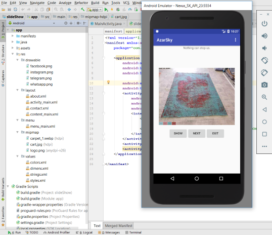

<h2>Simple android programs</h2>

Android is a mobile operating system based on a modified version of the Linux kernel. It is free and open source software; its source code is known as Android Open Source Project (AOSP).

<h3>Azarsky app</h3>

This app’s been made for our company named “Azarsky” to 
make online show as new carpets were passed final finishing (technically an offline/online show 
with secure connection to website/server to update databases/resources).

<figure>
  
  <figcaption style="text-align: center; padding-left:45%;">Azar Sky App</figcaption>
</figure> 

I used to build my applications with Eclipse IDE and now all of it is integrated in android studio (Google’s Android operating system IDE built on JetBrains IntelliJ IDEA). As seen in above picture, we could use “Android Emulator” to try our apps on many platforms or online in our phone connected to the PC.

